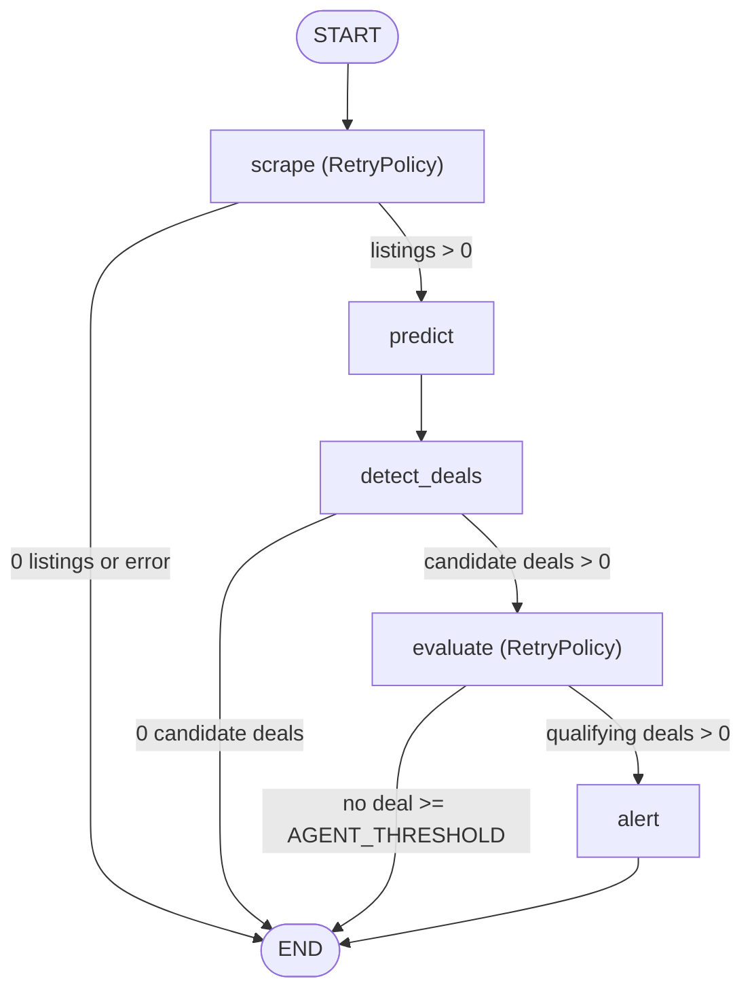

#  CarScout — Autonomous AI Car Deal Finder

> Find underpriced cars on PakWheels.com automatically — using ML price prediction, 
> a Groq-powered AI agent, real-time Telegram/email alerts, and a live Gradio dashboard.

---

## 📸 Dashboard Preview

GaadiScout's 4-tab Gradio dashboard gives you:
- **Live Deals** — sortable/filterable table of all current deals
- **Price Analysis** — scatter plot (listed vs predicted price) + discount distribution
- **Agent Reasoning** — expandable AI analysis cards with risk flags per deal  
- **Alert History** — log of every Telegram/email alert sent

---

##  Architecture

```
PakWheels.com
      │
      ▼
 scraper.py ──────────────────────────────► db.py (SQLite)
                                               │
                                        ┌──────┴──────┐
                                        ▼             ▼
                                  predict.py    deal_detector.py
                                  (statistical   (flags listings
                                  OR fine-tuned) ≥15% below market)
                                                      │
                                                      ▼
                                                  agent.py
                                              (Groq LLM scores
                                               deals 1-10, detects
                                               risk flags)
                                                  │
                                        ┌─────────┴─────────┐
                                        ▼                   ▼
                               telegram_bot.py         email_alert.py
                                                            │
                                        ┌───────────────────┘
                                        ▼
                               dashboard.py (Gradio)
                               ├── Tab 1: Live Deals
                               ├── Tab 2: Price Analysis
                               ├── Tab 3: Agent Reasoning
                               └── Tab 4: Alert History

Automation: .github/workflows/run_pipeline.yml (every 3 hours, GitHub Actions)
```

### LangGraph Orchestration (`PIPELINE_ENGINE=langgraph`)

When `PIPELINE_ENGINE=langgraph` is set (default is `legacy`), `main.py` delegates orchestration to `graph_pipeline.py`, which runs a `StateGraph` with retry policies on `scrape` and `evaluate` and conditional edges to exit early when no listings or deals qualify:



---

## 🛠️ Tech Stack

| Component | Tool | Cost |
|-----------|------|------|
| Scraping | `requests` + `BeautifulSoup4` | Free |
| Database | SQLite | Free (built-in) |
| Price prediction | Statistical median + QLoRA fine-tuning | Free |
| Fine-tuning | HuggingFace `transformers`, `peft`, `trl`, Colab GPU | Free |
| AI Agent | Groq API + LangChain (`llama-3.1-8b-instant`) | Free tier |
| Alerts | Telegram Bot API + Gmail SMTP | Free |
| Dashboard | Gradio | Free |
| Hosting | Hugging Face Spaces | Free |
| Automation | GitHub Actions | Free (2000 min/month) |

---

##  Quick Start

### 1. Clone & install dependencies

```bash
git clone https://github.com/your-username/gaadiscout.git
cd gaadiscout
pip install -r requirements.txt
```

### 2. Configure environment variables

```bash
cp .env.example .env
# Edit .env with your API keys (see "Getting API Keys" section below)
```

### 3. Run the pipeline once

```bash
python main.py
```

### 4. Launch the dashboard

```bash
python dashboard.py
# Open http://localhost:7860
```

### 5. (Optional) Run individual modules for testing

```bash
python db.py          # Initialise DB + insert test row
python scraper.py     # Scrape 2 pages, print sample listing
python predict.py     # Test price prediction
python deal_detector.py # Detect deals in DB
python agent.py       # Evaluate a mock deal with AI
python telegram_bot.py  # Send a test Telegram message
python email_alert.py   # Send a test email
```

---

##  Getting Free API Keys

### Groq API (AI Agent)
1. Go to [console.groq.com](https://console.groq.com)
2. Sign up for free (no credit card required)
3. Go to **API Keys** → **Create API Key**
4. Add to `.env`: `GROQ_API_KEY=your_key`

**Free tier:** 14,400 requests/day with `llama-3.1-8b-instant` ✅

---

### Telegram Bot
1. Open Telegram and search for `@BotFather`
2. Send `/newbot` and follow the prompts
3. Copy the bot token to `.env`: `TELEGRAM_BOT_TOKEN=...`
4. Start a chat with your new bot
5. Get your Chat ID by messaging `@userinfobot` on Telegram
6. Add to `.env`: `TELEGRAM_CHAT_ID=your_chat_id`

**Free tier:** Unlimited messages ✅

---

### Gmail SMTP (Email Alerts)
1. Enable 2-Factor Authentication on your Google account
2. Go to [myaccount.google.com/apppasswords](https://myaccount.google.com/apppasswords)
3. Create an App Password for "Mail" → "Windows Computer" (or any)
4. Copy the 16-character password (no spaces)
5. Add to `.env`:
   ```
   EMAIL_SENDER=your@gmail.com
   EMAIL_APP_PASSWORD=xxxx xxxx xxxx xxxx
   EMAIL_RECIPIENT=recipient@example.com
   ```

**Free tier:** 500 emails/day 

---

### Hugging Face Token
1. Go to [huggingface.co/settings/tokens](https://huggingface.co/settings/tokens)
2. Click **New token** → Type: **Read**
3. Add to `.env`: `HF_TOKEN=hf_...`

Needed for: downloading models, pushing your fine-tuned adapter.  
**Free tier:** Unlimited downloads of public models 

---

## 🤖 QLoRA Fine-Tuning (Optional)

The price predictor works **out-of-the-box** using statistical median prediction.  
Once you have scraped enough data (100+ listings), you can fine-tune a small LLM 
for better predictions using **Google Colab's free GPU**.

### Steps:
1. Run the pipeline a few times to collect listings: `python main.py`
2. Upload `gaadiscout.db` to Google Colab: `/content/gaadiscout.db`
3. Open `train_model.py` in Colab and run the cells in order
4. After training, download `./lora_adapter/` to your project root
5. Set `PREDICTION_MODE=finetuned` in `.env`

**Recommended base models (both free on HF Hub):**
- `Qwen/Qwen2.5-1.5B-Instruct` (1.5B params, ~2GB VRAM)
- `meta-llama/Llama-3.2-1B-Instruct` (1B params, requires HF token)

---

## 🚀 Deploying to Hugging Face Spaces

1. Create a new Space at [huggingface.co/new-space](https://huggingface.co/new-space)
   - SDK: **Gradio**
   - Visibility: Public or Private
2. Push your code:
   ```bash
   git remote add hf https://huggingface.co/spaces/your-username/gaadiscout
   git push hf main
   ```
3. Add Secrets in Space Settings → Repository Secrets:
   - `GROQ_API_KEY`, `TELEGRAM_BOT_TOKEN`, `TELEGRAM_CHAT_ID`
   - `EMAIL_SENDER`, `EMAIL_APP_PASSWORD`, `EMAIL_RECIPIENT`
   - `HF_TOKEN`

The `app.py` file is the Spaces entry point.

---

## ⏰ Automating with GitHub Actions

The workflow `.github/workflows/run_pipeline.yml` runs automatically every 3 hours.

### Setup:
1. Push code to GitHub
2. Go to **Settings → Secrets and variables → Actions**
3. Add these secrets:
   - `GROQ_API_KEY`
   - `TELEGRAM_BOT_TOKEN`
   - `TELEGRAM_CHAT_ID`
   - `EMAIL_SENDER`
   - `EMAIL_APP_PASSWORD`
   - `EMAIL_RECIPIENT`
   - `HF_TOKEN`
4. Enable Actions in the **Actions** tab

### Manual trigger:
Go to **Actions** → **GaadiScout Pipeline** → **Run workflow** →  
Optionally set max pages, deal threshold, or disable alerts for a dry run.

> **Note:** GitHub Actions free tier gives 2,000 minutes/month.  
> Running every 3 hours = 8 runs/day × ~3 min/run = 24 min/day = ~720 min/month. ✅

---

## ⚙️ Configuration Reference

| Environment Variable | Default | Description |
|---------------------|---------|-------------|
| `SCRAPE_MAX_PAGES` | `5` | Max pages to scrape per run (~24 listings/page) |
| `SCRAPE_DETAILS` | `false` | Also fetch each listing's detail page (slower) |
| `DEAL_THRESHOLD` | `15.0` | Min % below predicted price to flag as deal |
| `AGENT_THRESHOLD` | `7` | Min agent score (1-10) to send alerts |
| `PREDICTION_MODE` | `auto` | `auto` / `statistical` / `finetuned` |
| `ENABLE_TELEGRAM` | `true` | Enable/disable Telegram alerts |
| `ENABLE_EMAIL` | `true` | Enable/disable email alerts |
| `AGENT_MODEL` | `llama-3.1-8b-instant` | Groq model for deal evaluation |
| `BASE_MODEL_ID` | `Qwen/Qwen2.5-1.5B-Instruct` | Base model for fine-tuning |

---

## 🛡️ Ethical Scraping Policy

GaadiScout respects PakWheels.com's `robots.txt`:
- ✅ Only scrapes **public search result pages** (`/used-cars/search/-/`)  
- ✅ Uses a descriptive **User-Agent** identifying the bot and its purpose
- ✅ Adds **1–2.5 second random delays** between all requests
- ✅ Never requests disallowed paths (`/notify_seller`, `/manage/`, `?sortby=`, etc.)
- ✅ Handles pagination politely, stops at the last page
- ⚠️ For production use, consider caching aggressively and limiting run frequency

---

## 📁 Project Structure

```
gaadiscout/
├── scraper.py           # PakWheels scraper
├── db.py                # SQLite database layer
├── predict.py           # Statistical + fine-tuned price predictor
├── train_model.py       # QLoRA fine-tuning script (run on Colab)
├── deal_detector.py     # Deal flagging logic
├── agent.py             # Groq LLM deal evaluator
├── telegram_bot.py      # Telegram alert sender
├── email_alert.py       # Gmail SMTP alert sender
├── dashboard.py         # Gradio dashboard (4 tabs)
├── main.py              # Pipeline orchestrator
├── app.py               # Hugging Face Spaces entry point
├── requirements.txt     # Python dependencies
├── .env.example         # Environment variable template
├── .env                 # Your real credentials (git-ignored)
├── gaadiscout.db        # SQLite database (git-ignored, created at runtime)
├── lora_adapter/        # Fine-tuned model adapter (git-ignored, from Colab)
└── .github/
    └── workflows/
        └── run_pipeline.yml  # GitHub Actions cron workflow
```

---

##  .gitignore Recommendations

Add this to your `.gitignore`:
```
.env
gaadiscout.db
lora_adapter/
__pycache__/
*.pyc
.DS_Store
```

---

##  License

MIT License — free for personal and educational use.

---

*Built with ❤️ using open-source tools. Not affiliated with PakWheels.com.*
